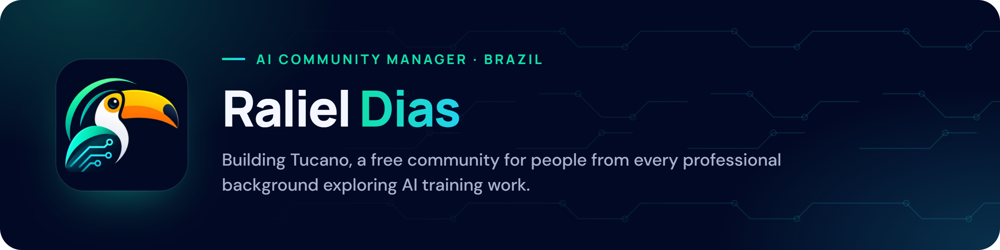

Hi, I'm Raliel. I manage **Tucano**, a free, independent community for people exploring AI training work: the remote, project-based work of evaluating, writing and labeling the data that AI models learn from.

Developers, teachers, marketers, video editors, finance professionals, cooks and people from many other fields bring valuable expertise to this work. At Tucano we help them understand how it operates, prepare honest, strong applications and stay safe along the way.

## Featured: Tucano AI Training Resources

Free guides, with platform details taken only from official sources. [Browse the repository →](https://github.com/radiaswebempreendimentosdigita-cloud/tucano-ai-training-resources)

| Guide | What it covers |
| :--- | :--- |
| [Beginner's guide](https://github.com/radiaswebempreendimentosdigita-cloud/tucano-ai-training-resources/blob/main/guides/beginners-guide.md) | What the work involves, how getting started usually goes, and how to stay safe |
| [Platform directory](https://github.com/radiaswebempreendimentosdigita-cloud/tucano-ai-training-resources/blob/main/guides/platform-directory.md) | 15 platforms with official links and sourced details |
| [Application checklist](https://github.com/radiaswebempreendimentosdigita-cloud/tucano-ai-training-resources/blob/main/guides/application-checklist.md) | Preparing your profile, assessments, identity checks and payment |
| [Task types and skills](https://github.com/radiaswebempreendimentosdigita-cloud/tucano-ai-training-resources/blob/main/guides/task-types-and-skills.md) | Common tasks, and how your background fits them |

Corrections and updates are welcome. See the [contributing guidelines](https://github.com/radiaswebempreendimentosdigita-cloud/tucano-ai-training-resources/blob/main/CONTRIBUTING.md).

## Join the community

Tucano is free, with no paid tiers. It's independent of the platforms we write about, and we never promise acceptance or earnings.

**Find us at [jointucano.com](https://jointucano.com).**
